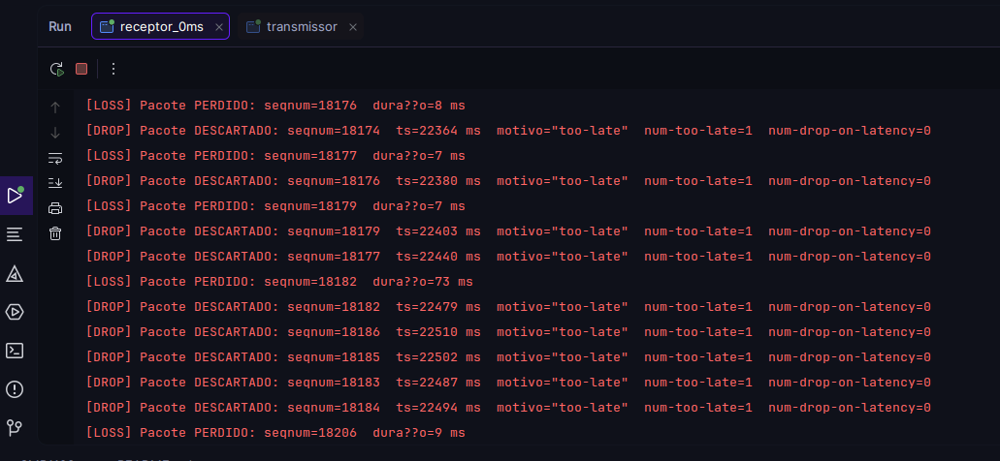
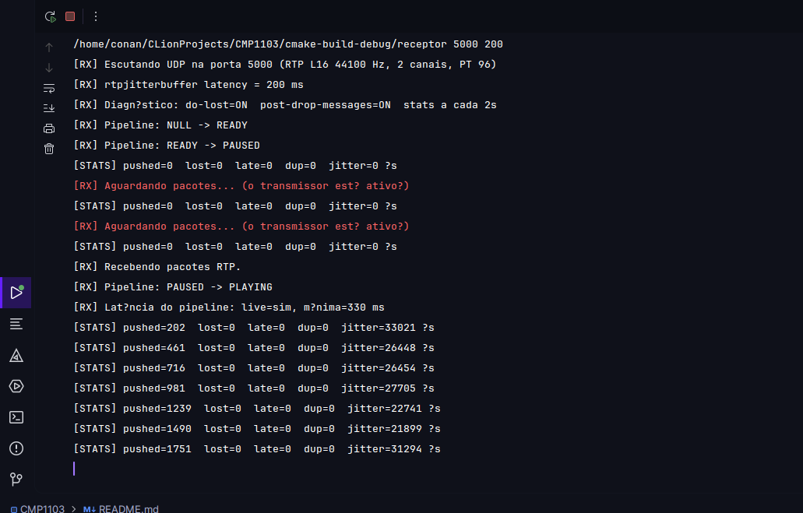
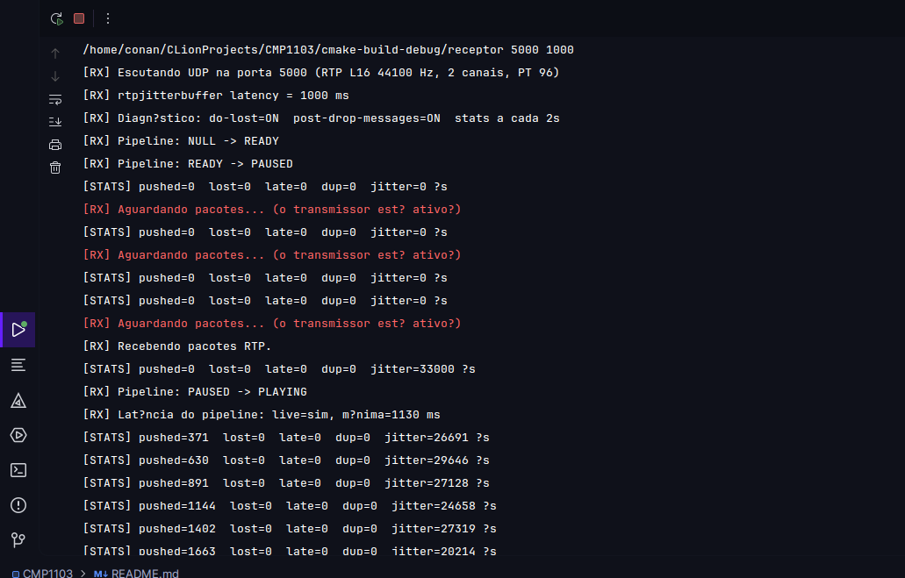
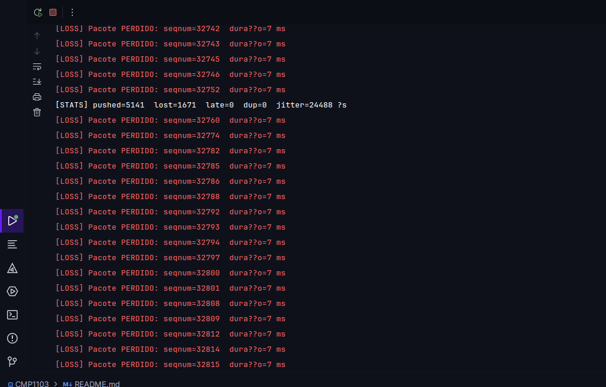

# Relatório de Experimentos — Streaming de Áudio RTP/UDP com GStreamer

**Disciplina:** CMP1103  
**Tema:** Controle de jitter/latência e diagnóstico de perda de pacotes com `rtpjitterbuffer`

---

## 1. Registro dos Experimentos

### 1.1 Ambiente e configuração comum

| Item | Valor |
|---|---|
| Sistema / IDE | Fedora Linux, CLion (build `cmake-build-debug`) |
| Transporte | Loopback (`127.0.0.1`), UDP, porta **5000** |
| Payload | RTP L16 (PCM 16 bits big-endian), **44100 Hz**, **2 canais**, PT **96** |
| Transmissor | `./transmissor 127.0.0.1 5000 test` (senoide de 440 Hz) |
| Receptor | `./receptor 5000 <latência_ms>` |
| Pipeline do receptor | `udpsrc → rtpjitterbuffer → rtpL16depay → queue → audioconvert → audioresample → autoaudiosink` |
| Diagnóstico habilitado | `do-lost=TRUE`, `post-drop-messages=TRUE`, leitura da propriedade `stats` a cada 2 s |

A degradação de rede foi emulada na interface `lo` com `tc`/`netem`:

```bash
# Atraso médio de 50 ms com variação (jitter) de ±40 ms
sudo tc qdisc add dev lo root netem delay 50ms 40ms

# Perda de 30% combinada com o mesmo atraso/jitter
sudo tc qdisc add dev lo root netem loss 30% delay 50ms 40ms

# Restauração da interface após cada experimento
sudo tc qdisc del dev lo root
```

Nos logs, `[LOSS]` corresponde ao evento downstream `GstRTPPacketLost`, `[DROP]` às mensagens de bus `drop-msg` e `[STATS]` à leitura periódica da propriedade `stats` do `rtpjitterbuffer`.

---

### 1.2 Experimento A — Influência da latência do `rtpjitterbuffer`

**Parâmetros.** Porta 5000; emulação de jitter com `netem delay 50ms 40ms` (atrasos individuais entre ~10 ms e ~90 ms); a propriedade `latency` do `rtpjitterbuffer` foi variada em três valores: **0 ms**, **200 ms** e **1000 ms** (segundo argumento do receptor).

#### A.1 Latência = 0 ms (`./receptor 5000 0`)

**Resultados observados.** Sem janela de espera, qualquer pacote que chega depois do instante em que deveria ser reproduzido é rejeitado. O log do receptor mostra sequências contínuas de `[DROP]` com motivo `too-late` (contador `num-too-late` crescente), acompanhadas de `[LOSS]` para os mesmos números de sequência (por exemplo, `seqnum=18176`, `18177`, `18179`, `18182`). Observa-se também que pacotes chegam fora de ordem (`18186` antes de `18185`, `18183` e `18184`), e como não há tempo de reordenação, o jitterbuffer declara os intermediários como perdidos e descarta-os quando chegam. Auditivamente, o áudio apresentou **cortes e interrupções frequentes**, e o tom contínuo deixou de ser uniforme.



#### A.2 Latência = 200 ms (`./receptor 5000 200`)

**Resultados observados.** O receptor reportou latência mínima do pipeline de **330 ms** (200 ms do jitterbuffer mais a latência do sink de áudio). As estatísticas permaneceram em `lost=0 late=0 dup=0`, com `pushed` crescendo em torno de 250 pacotes por intervalo de 2 s, e jitter médio entre ~22 ms e ~33 ms. Como o atraso máximo emulado (~90 ms) é inferior a 200 ms, todos os pacotes chegaram dentro da janela e foram reordenados corretamente. O áudio foi **contínuo e sem cortes**, com atraso moderado entre transmissão e reprodução.



#### A.3 Latência = 1000 ms (`./receptor 5000 1000`)

**Resultados observados.** A latência mínima do pipeline foi de **1130 ms**. As estatísticas também ficaram em `lost=0 late=0 dup=0` (`pushed` > 1600 ao final do trecho capturado), com jitter médio de ~20 a ~30 ms, equivalente ao observado a 200 ms. O áudio permaneceu **limpo, porém com atraso claramente perceptível** (superior a um segundo) entre a origem e a reprodução, além de um tempo inicial maior até o início do som (estado `PAUSED → PLAYING` só após o preenchimento do buffer).



#### A.4 Síntese comparativa

| Latência configurada | Latência do pipeline | Perdas/descartes sob jitter 50±40 ms | Qualidade do áudio |
|---|---|---|---|
| 0 ms | — | Muitos `[LOSS]`/`[DROP] too-late` | Cortes frequentes |
| 200 ms | 330 ms | `lost=0`, `late=0` | Contínuo, atraso moderado |
| 1000 ms | 1130 ms | `lost=0`, `late=0` | Contínuo, atraso alto |

---

### 1.3 Experimento B — Diagnóstico de perda de pacotes

**Parâmetros.** Porta 5000; emulação de perda com `netem loss 30% delay 50ms 40ms`; transmissor `127.0.0.1 5000 test`; receptor com diagnóstico completo habilitado. Ao final, a regra foi removida com `sudo tc qdisc del dev lo root`.

**Resultados observados.** O console registrou uma sequência de eventos `[LOSS]` com números de sequência não consecutivos (por exemplo `32742`, `32743`, `32745`, `32746`, `32752`, `32760`, `32774`), caracterizando perdas independentes e em rajadas curtas, cada uma com duração estimada de 7 ms (1 pacote RTP de ~7 ms de áudio). A linha de estatísticas ao final do trecho indica `pushed=5141`, `lost=1671`, `late=0`, `dup=0` e jitter médio de ~24 ms, o que equivale a uma taxa de perda de cerca de **24,5%** (1671 / (5141 + 1671)). Esse valor é compatível com os 30% configurados, considerando que o `netem` aplica a perda de forma probabilística e que o contador `lost` reflete o momento da captura. Auditivamente, o áudio apresentou **falhas e interrupções constantes**, pois o fluxo é PCM sem retransmissão ou correção de erros (FEC): o receptor apenas sinaliza e oculta a lacuna. O contador `late=0` indica que, nessa captura, os pacotes ausentes nunca chegaram (perda real), em vez de chegarem atrasados.



---

## 2. Conclusão

### 2.1 Trade-off entre latência e estabilidade

O `rtpjitterbuffer` introduz um atraso deliberado, definido pela propriedade `latency`, para absorver a variação do tempo de chegada dos pacotes (jitter) e restaurar a ordem de reprodução. Os experimentos evidenciaram o compromisso:

- **Latência insuficiente (0 ms):** o buffer não dispõe de tempo para aguardar pacotes atrasados ou reordenar os que chegam fora de sequência. Os pacotes que excedem o prazo de reprodução são marcados como perdidos e descartados (`too-late`), degradando o áudio mesmo quando não houve perda real na rede.
- **Latência compatível com o jitter (200 ms):** como a janela é maior que o atraso máximo emulado (~90 ms), todos os pacotes foram reordenados e entregues no prazo (`lost=0`, `late=0`), com latência fim a fim de ~330 ms.
- **Latência excessiva (1000 ms):** a estabilidade não melhorou em relação a 200 ms nesse cenário, pois não havia jitter que a justificasse, enquanto a latência fim a fim ultrapassou 1,1 s, o que é inviável para aplicações interativas (voz, videoconferência).

Conclui-se que a latência do buffer deve ser dimensionada em função do jitter máximo esperado da rede: valores menores reduzem o atraso, mas aumentam descartes; valores maiores aumentam a robustez ao custo de atraso. Vale ressaltar que o buffer **mitiga o jitter e a reordenação, mas não recupera pacotes efetivamente perdidos** (experimento B): para isso seriam necessários mecanismos adicionais, como retransmissão (RTX), FEC ou ocultação de perdas (PLC).

### 2.2 Eficácia dos mecanismos de diagnóstico do GStreamer

Os três mecanismos adotados mostraram-se complementares:

1. **Eventos downstream (`do-lost` → `GstRTPPacketLost`):** fornecem, em tempo real, o número de sequência e a duração de cada lacuna, permitindo identificar com precisão quais pacotes não foram entregues e se as perdas ocorrem de forma isolada ou em rajadas. Foram a evidência direta da perda emulada no Experimento B.
2. **Mensagens de bus (`post-drop-messages` → `drop-msg`):** distinguem *por que* um pacote foi descartado (`too-late` ou estouro por `drop-on-latency`). No Experimento A com 0 ms, foram decisivas para demonstrar que a degradação decorria de chegada fora do prazo, e não de perda na rede.
3. **Estatísticas (`stats`):** a leitura periódica de `num-pushed`, `num-lost`, `num-late`, `num-duplicates` e `avg-jitter` produziu uma visão agregada e quantitativa, permitindo estimar a taxa de perda (~24,5%), verificar que o jitter médio (~20–30 ms) era coerente com o `netem` e confirmar a ausência de descartes nos testes de 200 ms e 1000 ms.

Em conjunto, esses recursos permitiram correlacionar a degradação perceptível no áudio com sua causa técnica, validando tanto o controle de jitter pelo `rtpjitterbuffer` quanto a capacidade de observação do fluxo RTP no GStreamer.

---

> **Nota sobre os logs:** acentos aparecem corrompidos nos prints (`dura??o`, `Diagn?stico`) por uma incompatibilidade de codificação do console do CLion com a saída do programa; não afeta os resultados.
